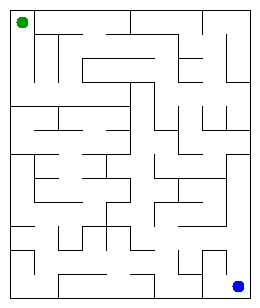

# Assignment 3. Maze Escape

Student ID: 250300
Name: Nariman Serikkali
Group: SE-2536
Maze size (rows x columns): 12 x 10

This file is the report. Fill it in as you go. How to start: `START_HERE.md`. The task: `docs/Assignment3.pdf`.

## Program output

The 13 lines your program prints on your data (`java -cp out Main`):

    Broken: 119
    Kept: 99 
    Last broken wall: 175
    MST cost: 31131
    Heaviest broken wall: 743
    Path length: 32
    DFS visited: 66
    Dead ends: 38
    Zones: 10
    Largest zone: 19
    Is DAG: 0
    Flow stages: 6
    Fastest route cost: 9

My maze:

## Questions

Answer in your own words, two or three sentences each.

Mission 0. What do find and union do, and what makes them fast in your code?
find(x) returns the root of the set of x and on the way it hangs every visited cell directly under the root (path compression). union(a, b) finds both roots, returns false if they are the same, otherwise puts the smaller tree under the larger one (union by size), decreases the set counter and returns true. These two tricks keep the trees almost flat, so both operations are almost constant time.
Mission 1. Why is Broken always R*C - 1, and Kept always (R-1)*(C-1)?
At the start there are RC separate sets. Every successful union merges two sets, so the number of sets drops by exactly 1. In the end the maze is connected (one set), so there are exactly RC - 1 successful unions, that is Broken. The grid has R*(C-1) + C*(R-1) walls in total, so Kept = 2RC - R - C - (RC - 1) = (R-1)*(C-1). For my 12 x 10: 119 and 99.
Mission 2. My MST cost from Kruskal and from Prim, and why they are equal:
Kruskal and Prim both give 31131. They are equal because both build a minimum spanning tree, and since all wall costs are different, the cheapest spanning tree is unique.
Mission 3. Why is there exactly one path between two cells? How did you avoid a stack overflow on a huge maze?
The broken walls connect all RC cells with RC - 1 walls and no cycle (a wall between already connected cells is never broken), so the maze is a tree. In a tree there is a path between two cells, and two different paths would make a cycle, so it is exactly one. To avoid a stack overflow I wrote DFS without recursion: my own array is the stack (it holds the current path) and an array next remembers which direction to try next for every cell. An array on the heap can hold a million cells, the call stack cannot.
Mission 4. Why does the second pass of Kosaraju go on the reversed graph? Why do the slides have no cycle exactly when Zones equals the number of cells?
The cell that is finished last in the first pass is in a zone from which slides go out to other zones. In the reversed graph those slides point into this zone, not out of it, so DFS from this cell reaches only the cells of its own zone. That is why the second pass on the reversed graph finds exactly one zone at a time. If there is a cycle, the cells of the cycle can reach each other, so they are in one zone and Zones is less than the number of cells. If there is no cycle, no two cells can reach each other, so every cell is its own zone and Zones equals the number of cells.
Mission 5. Why is it enough to go through the zones in the order of their numbers? What does this pass cost?
The zones are numbered in topological order: every slide between zones goes from a smaller number to a larger one. When the loop reaches a zone, all slides into it come from zones with smaller numbers, which are already processed, so its longest chain and cheapest cost are final. The pass costs O(n + m): counting sort of the slides by zone, then one pass over the zones and slides, no priority queue and no log factor.
## AI use

The syllabus requires you to say which AI tools you used and for what. Write the tool (ChatGPT, Copilot, other) and what you asked it: explain an idea, find an error, review code. Write "none" if you did not use any. If you took code or text from a book or a website, give the source here.
I used Gemini as a learning assistant to better understand the algorithms and debug my code. Specifically, I asked it to explain the theory behind path compression in DSU and to help me figure out how to avoid a stack overflow in my DFS implementation. I also used it to review my logic for Kosaraju's second pass. All the final code and written answers in this report were structured and typed by me.
## Timing (Mission 7)

Milliseconds, 5 runs each, from `java -cp out Bench`.

| maze | Kruskal | Prim |
|---|----|----|
| 100 x 100 | 33 | 23 |
| 300 x 300 | 143 | 158 |
| 1000 x 1000 | 2622 | 3610 |

What do the numbers say about how the time grows? Two or three sentences.

## Complexity

n is the number of cells, m the number of walls (or slides). Fill in every algorithm you wrote.

| algorithm | time | space     | assumptions                                   |
|---|------|-----------|-----------------------------------------------|
| DSU find and union | O(α(n)), almost constant | O(n)      | union by size and path compression, amortized |
| Kruskal | O(m log m) | O(n + m)  | sorting the walls dominates, DSU is almost constant |
| Prim | 	O(m log m) | 	O(n + m) |  binary heap (PriorityQueue), neighbour lists, every wall enters the heap at most twice |
| DFS | O(n) | 	O(n)     | 	maze is a tree with n - 1 open doors, own stack, each cell visited once |
| Kosaraju | 	O(n + m) | 	O(n + m) | two DFS passes, normal and reversed slide lists |
| Route in the zone graph | O(n + m) | 	O(n + m) | counting sort of slides by zone, one pass in zone order, no priority queue |

## Before you submit

- data/walls.txt, data/slides.txt and output/maze.png are in the repository.
- `java tools/Check.java` shows all examples right.
- This README is filled in, the program output and the section AI use included.
- The work is pushed to main (at least one commit per mission) and the repository is public.
- The link is attached in Moodle.
